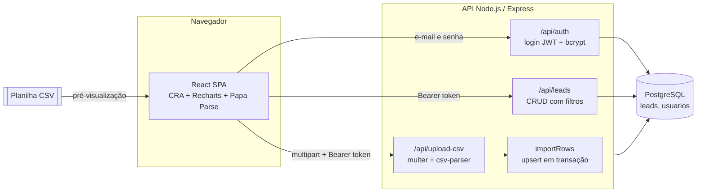

# Painel de Leads: acompanhamento do funil de vendas

Painel web para a equipe comercial acompanhar leads da captação ao fechamento. A equipe já trabalhava numa planilha (curso de interesse, perfil de origem, status do lead, status da venda, follow-up, responsável). O painel transforma essa planilha num sistema: **importa o CSV** exportado dela, mostra **indicadores por status** e um **gráfico de distribuição**, permite **filtrar, buscar, criar, editar e excluir** leads, e reimportar a planilha atualizada sem duplicar ninguém (o telefone é a chave).

> **Sobre esta versão:** versão anonimizada de um sistema que construí e que roda em produção para uma empresa; nomes, marca, domínios, conteúdo proprietário e dados foram substituídos por fictícios.

**English summary:** Full-stack sales-pipeline dashboard for leads (React 18 + Create React App + Recharts / Node.js + Express + PostgreSQL). The sales team uploads the CSV exported from their spreadsheet; the API parses it as a stream and upserts every row in a single transaction, using the phone number as the natural key (`INSERT ... ON CONFLICT ... RETURNING (xmax = 0)` tells inserts from updates). The dashboard shows status cards, a pie chart, filters, search, pagination and a CRUD modal. JWT login with bcrypt, rate-limited login, restricted CORS and a size/type-limited upload. Runs locally with one `docker compose up`.

---

## Sumário

- [O que o painel faz](#o-que-o-painel-faz)
- [Arquitetura](#arquitetura)
- [Stack](#stack)
- [Rodar localmente](#rodar-localmente)
- [Conta de demonstração](#conta-de-demonstração)
- [Roteiro para testar](#roteiro-para-testar)
- [API](#api)
- [Integrações](#integrações)
- [Segurança](#segurança)
- [Estrutura do repositório](#estrutura-do-repositório)
- [Variáveis de ambiente](#variáveis-de-ambiente)
- [Decisões técnicas](#decisões-técnicas)

---

## O que o painel faz

### Painel

| Área | O que faz |
|---|---|
| **Login** | Acesso por e-mail e senha. Não existe cadastro aberto: usuários são criados por script (`npm run user:create`). |
| **Indicadores** | Cards com o total de leads e a contagem por status (follow-up, qualificados, em análise, não qualificados). Os números seguem os filtros aplicados. |
| **Gráfico** | Pizza com a distribuição dos leads por status e o percentual de cada fatia (Recharts). |
| **Filtros e busca** | Filtro por status, responsável, curso e origem, com opções montadas a partir dos dados. Busca por nome. Paginação de 10 em 10. |
| **Cadastro e edição** | Modal com todos os campos da planilha: data, nome, curso, origem, telefone, e-mail, status do lead, status da venda, valor, data do follow-up, responsável e observações. Erros de validação (telefone obrigatório, telefone ou e-mail repetido) aparecem no próprio modal. |
| **Exclusão** | Com confirmação. |
| **Importar planilha** | Upload de CSV com pré-visualização das 5 primeiras linhas (Papa Parse no navegador), barra de progresso do envio e resumo no fim: quantos leads foram adicionados, atualizados e quantas linhas tinham erro. |

### Campos de um lead

`data`, `curso`, `instagram_de_origem`, `nome_do_lead`, `telefone`, `email` (na planilha a coluna se chama `e_mail`), `status_do_lead`, `status_de_venda`, `valor_da_venda`, `data_do_follow_up`, `responsavel`, `observacoes`.

Status usados pela planilha e pelo painel:

- **Lead:** 🟡 EM ANÁLISE, 🟢 QUALIFICADO, 🔵 FOLLOW-UP, 🔴 NÃO QUALIFICADO
- **Venda:** ⏳ AGUARDANDO, 💰 EM NEGOCIAÇÃO, ✅ VENDEU, ❌ NÃO VENDEU

Os selects do formulário juntam essa lista com os valores que já existem no banco, então uma planilha com outros status continua editável.

---

## Arquitetura



**Fluxo da importação**

1. O navegador lê o CSV com Papa Parse só para mostrar a pré-visualização.
2. O arquivo vai por `multipart/form-data` (campo `csvFile`) para `POST /api/upload-csv`. O multer grava um arquivo temporário fora do projeto, aceita só `.csv` e limita o tamanho.
3. O `csv-parser` lê o arquivo como stream. Os cabeçalhos são normalizados (BOM do Excel e espaços).
4. Todas as linhas entram numa única transação. Cada linha é validada (telefone obrigatório): as inválidas são puladas e listadas no resumo, as válidas viram `INSERT ... ON CONFLICT (telefone) DO UPDATE`.
5. `RETURNING (xmax = 0)` diz se a linha foi inserida ou atualizada, e a resposta traz os totais. Se algo falhar no banco, a transação inteira volta e nada é gravado pela metade.
6. O arquivo temporário é apagado em qualquer caso.

---

## Stack

**Frontend:** React 18, Create React App (react-scripts 5), Axios, Recharts, Papa Parse, Font Awesome (CDN), CSS próprio com variáveis.

**Backend:** Node.js 22, Express 4, PostgreSQL (`pg`), multer, csv-parser, jsonwebtoken, bcryptjs, express-rate-limit, cors, dotenv.

**Testes:** `node:test` na API, Jest + Testing Library no front.

**Infra:** Dockerfile da API (roda sem root), Dockerfile do front em duas etapas (build com Node, arquivos servidos pelo nginx) e `docker-compose` para o ambiente local. O workflow de CI só faz build e testes. A configuração de deploy da produção foi retirada deste repositório.

---

## Rodar localmente

### Opção 1: Docker (recomendado)

Pré-requisito: Docker Desktop.

```bash
git clone https://github.com/vitormouramaker/lead-pipeline-dashboard.git
cd lead-pipeline-dashboard
docker compose up --build
```

- Front: http://localhost:3000
- API: http://localhost:5000/health

Na subida, a API cria as tabelas, a [conta de demonstração](#conta-de-demonstração) e 40 leads fictícios. O seed roda a cada subida: os 40 leads de exemplo voltam ao estado da planilha, e os leads que você criar continuam lá. Para zerar tudo, use `docker compose down -v`.

### Opção 2: Sem Docker

Pré-requisitos: Node.js 20+ e PostgreSQL 14+ rodando localmente.

```bash
# 1. API
cd backend
cp .env.example .env          # ajuste DB_USER / DB_PASSWORD / DB_PORT se precisar
npm install
npm run db:init               # cria o banco painel_leads e as tabelas
npm run seed:demo             # conta de demonstração + leads fictícios
npm run dev                   # http://localhost:5000

# 2. Front (outro terminal)
cd frontend
npm install
npm start                     # http://localhost:3000
```

O front usa `http://localhost:5000/api` por padrão. Para apontar para outra API, crie `frontend/.env.local` com `REACT_APP_API_URL=...` (veja `frontend/.env.example`). Se o front rodar em outra porta, inclua a origem em `CORS_ORIGIN` no `.env` da API.

### Testes

```bash
cd backend && npm test                         # regras de lead e da planilha
cd frontend && npm test -- --watchAll=false    # login, sessão e formatação de datas
```

---

## Conta de demonstração

Criada por `npm run seed:demo` (ou automaticamente no Docker). Existe só no seu banco local.

| E-mail | Senha |
|---|---|
| `demo@example.com` | **`Demo@1234`** |

Para outra senha: `DEMO_SENHA="OutraSenha@1" npm run seed:demo`. O seed se recusa a rodar com `NODE_ENV=production`.

Para criar outros usuários: `npm run user:create -- "Nome" pessoa@example.com "SenhaForte@123"`.

## Roteiro para testar

1. Entre com a conta de demonstração. Os cards, o gráfico e a tabela já mostram os 40 leads fictícios.
2. Filtre por responsável ou curso e veja os cards e o gráfico acompanharem o filtro. Busque por um nome.
3. Clique em **Adicionar Novo Lead**, cadastre um lead e depois edite o status dele pelo ícone de lápis.
4. Tente cadastrar outro lead com o mesmo telefone: o modal mostra "Telefone já cadastrado".
5. Clique em **Upload de Planilha** e envie [`backend/sample-data/leads-exemplo.csv`](backend/sample-data/leads-exemplo.csv). O resumo mostra 0 adicionados e 40 atualizados (o telefone já existia) e 1 linha com erro (a linha de exemplo sem telefone).
6. Edite o CSV (troque um status, acrescente uma linha com telefone novo) e envie de novo para ver o upsert.

---

## API

Tudo abaixo de `/api`, exceto login, exige `Authorization: Bearer <token>`.

| Método | Rota | O que faz |
|---|---|---|
| `GET` | `/health` | Saúde da API e do banco (público) |
| `POST` | `/api/auth/login` | `{ email, senha }` → `{ token, user }` |
| `GET` | `/api/auth/me` | Usuário do token |
| `GET` | `/api/leads` | Lista os leads. Filtros opcionais: `status_do_lead`, `responsavel`, `curso`, `instagram_de_origem`, `search` (nome, sem diferenciar maiúsculas) |
| `POST` | `/api/leads` | Cria um lead (telefone obrigatório) |
| `PUT` | `/api/leads/:id` | Atualiza um lead |
| `DELETE` | `/api/leads/:id` | Exclui um lead |
| `POST` | `/api/upload-csv` | Importa a planilha (campo `csvFile`) e devolve `{ message, added, updated, errors, messageErrors }` |

Exemplo:

```bash
TOKEN=$(curl -s -H 'Content-Type: application/json' \
  -d '{"email":"demo@example.com","senha":"Demo@1234"}' \
  http://localhost:5000/api/auth/login | node -pe 'JSON.parse(require("fs").readFileSync(0)).token')

curl -H "Authorization: Bearer $TOKEN" "http://localhost:5000/api/leads?responsavel=Ana%20Demo"
curl -H "Authorization: Bearer $TOKEN" -F csvFile=@backend/sample-data/leads-exemplo.csv \
  http://localhost:5000/api/upload-csv
```

---

## Integrações

O painel não depende de nenhum serviço externo. A entrada de dados é a planilha CSV exportada pela equipe, e o formato esperado é o de [`backend/sample-data/leads-exemplo.csv`](backend/sample-data/leads-exemplo.csv). O único recurso de terceiros carregado pelo navegador são as fontes (Google Fonts) e os ícones (Font Awesome via CDN).

---

## Segurança

- Login com senha em bcrypt e token JWT com validade (`JWT_EXPIRES_IN`, padrão 8h). Em produção a API não sobe sem `JWT_SECRET` (mínimo 32 caracteres).
- Todas as rotas de leads e de upload exigem token. O front limpa a sessão e volta ao login quando a API responde 401.
- Rate limit no login (20 tentativas a cada 15 minutos por IP). Quando o e-mail não existe, a API compara a senha com um hash fixo, para o tempo de resposta não revelar quais e-mails têm conta.
- CORS restrito às origens de `CORS_ORIGIN`. `x-powered-by` desligado.
- Consultas sempre parametrizadas. IDs validados antes de chegar ao banco.
- Upload limitado a um arquivo `.csv` de até `UPLOAD_MAX_MB` (padrão 5 MB), gravado no diretório temporário do sistema e apagado depois da importação.
- Mensagens de erro padrão, sem detalhes internos do banco. A imagem Docker da API roda como usuário sem privilégios.

---

## Estrutura do repositório

```
lead-pipeline-dashboard/
├── docker-compose.yml          # Postgres + API + front para rodar local
├── .github/workflows/ci.yml    # build e testes (sem deploy)
├── backend/
│   ├── server.js               # sobe a API depois de preparar o schema
│   ├── src/
│   │   ├── app.js              # Express: CORS, rotas de leads, upload, erros
│   │   ├── auth.js             # login, middleware do token, criação de usuário
│   │   ├── leads.js            # validação, normalização, upsert da planilha
│   │   ├── db.js               # pool do pg e schema idempotente
│   │   └── config.js           # variáveis de ambiente e padrões locais
│   ├── scripts/                # init do banco, seed de demo, criar usuário
│   ├── sample-data/            # planilha fictícia de exemplo
│   └── test/                   # testes com node:test
└── frontend/
    ├── public/                 # index.html, manifest e ícone
    └── src/
        ├── App.jsx             # sessão e painel (cards, gráfico, filtros, tabela, modal)
        ├── Login.jsx           # tela de login
        ├── CsvUploadComponent.jsx  # upload com pré-visualização e progresso
        ├── api.js              # cliente Axios com token e formatação de datas
        └── App.test.js
```

---

## Variáveis de ambiente

### API (`backend/.env.example`)

| Variável | Para quê | Padrão |
|---|---|---|
| `PORT` | Porta da API | `5000` |
| `DB_HOST`, `DB_PORT`, `DB_USER`, `DB_PASSWORD`, `DB_NAME` | Conexão com o PostgreSQL | `localhost`, `5432`, `postgres`, `postgres`, `painel_leads` |
| `JWT_SECRET` | Assinatura dos tokens (mínimo 32 caracteres). Obrigatória em produção. Em desenvolvimento, se vazia, a API gera uma aleatória a cada subida | valor de exemplo no `.env.example` |
| `JWT_EXPIRES_IN` | Validade do token | `8h` |
| `CORS_ORIGIN` | Origens liberadas, separadas por vírgula | `http://localhost:3000` |
| `UPLOAD_MAX_MB` | Tamanho máximo da planilha | `5` |
| `DEMO_SENHA` | Senha da conta criada pelo seed | `Demo@1234` |

### Front (`frontend/.env.example`)

| Variável | Para quê | Padrão |
|---|---|---|
| `REACT_APP_API_URL` | URL da API, com `/api` no fim. Entra no bundle na hora do build | `http://localhost:5000/api` |

---

## Decisões técnicas

- **Telefone como chave natural.** A planilha não tem ID, e o mesmo lead aparece de novo a cada exportação. O índice único em `telefone` permite reimportar a planilha inteira: quem já existe é atualizado, quem é novo é inserido. `RETURNING (xmax = 0)` separa os dois casos sem uma consulta extra.
- **Importação em uma transação.** Ou a planilha entra inteira, ou nada muda. Linhas sem telefone não derrubam a importação: são puladas e aparecem no resumo.
- **Mesma regra em todo lugar.** Validação, normalização (e-mail vazio vira `NULL` para não esbarrar no `UNIQUE`, valor aceita `1.997,00` e `1997.00`) e upsert ficam em `src/leads.js`, usado pela rota de upload e pelo seed.
- **Schema idempotente na subida.** `CREATE TABLE IF NOT EXISTS` e `CREATE UNIQUE INDEX IF NOT EXISTS` a cada start: um banco vazio fica pronto sem passo manual.
- **Datas sem surpresa de fuso.** Colunas `DATE` voltam do driver como texto `YYYY-MM-DD` e o front formata sem `new Date()`, para o follow-up não aparecer um dia antes no navegador.
- **Filtro no cliente.** A tabela recebe todos os leads uma vez e filtra, busca e pagina em memória com `useMemo`, o que deixa os cards e o gráfico instantâneos para o volume de uma equipe comercial. A API também aceita os mesmos filtros por query string.
- **Autenticação sem estado.** JWT no cabeçalho `Authorization` (sem cookie), o que dispensa sessão no servidor e evita CSRF. O upload usa `XMLHttpRequest` para ter progresso de envio e manda o mesmo token.

---

Autor: [@vitormouramaker](https://github.com/vitormouramaker)

Este código é exibido como portfólio. Ele não tem licença de uso aberta: todos os direitos são reservados.
